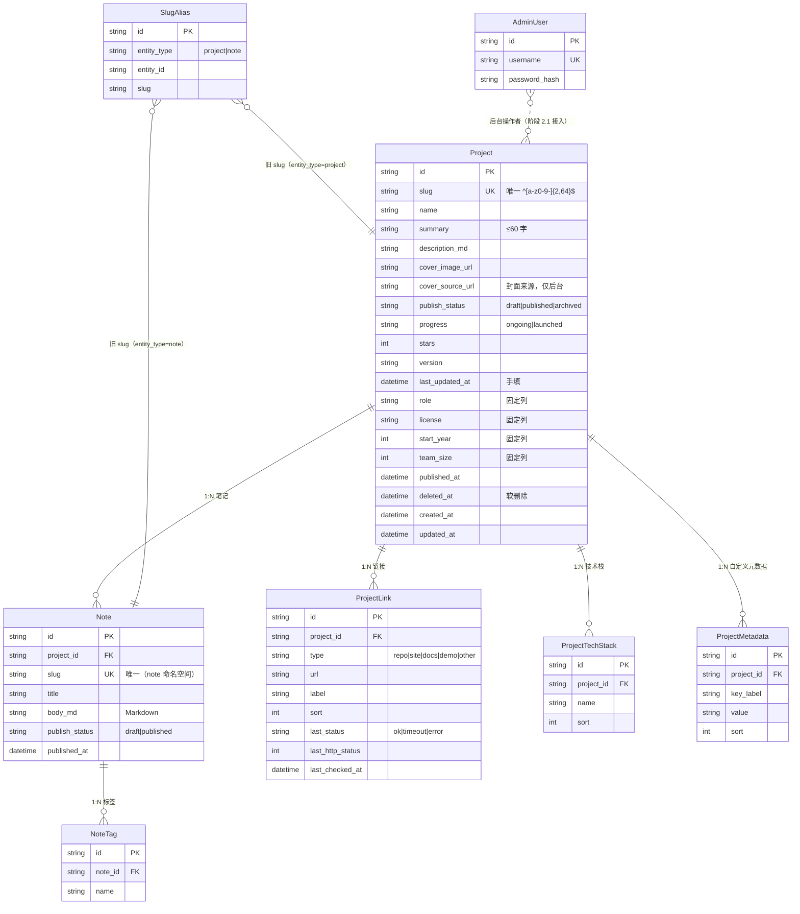

# 数据模型（冻结 · v1.2）

> 实现：`backend/prisma/schema.prisma`；迁移：`backend/prisma/migrations/`
> 数据库：SQLite（本地/CI），结构按「平滑迁 PostgreSQL」设计：不使用 SQLite 专有语法（N6），时间统一 UTC。
> 口径来源：《开发计划 v1.2》第五节。

## 1. ER 总览

## 2. 表与约束

| 表 | 关键约束 | 说明 |
|---|---|---|
| `projects` | `UNIQUE(slug)`；索引 `(publish_status, deleted_at)`、`(name)` | 曝光 `publish_status` 与进展 `progress` 正交；`deleted_at` 软删除 |
| `project_tech_stack` | `UNIQUE(project_id, name)`；索引 `(name)` | 技术栈并入项目（不再有独立 `technology` 表）；`sort` 即展示顺序 |
| `project_links` | 索引 `(project_id)` | `type` 枚举 v1.2 为 `repo/site/docs/demo/other`；`last_*` 由健康检查（阶段 2.6）维护 |
| `project_metadata` | `UNIQUE(project_id, key_label)` | 自由 KV；固定四列（role/license/start_year/team_size）不冗余进本表 |
| `notes` | `UNIQUE(slug)`；索引 `(project_id)`、`(publish_status)` | N:1 项目；草稿笔记前台不可见 |
| `note_tags` | `UNIQUE(note_id, name)` | 标签字符串，无独立标签表 |
| `slug_aliases` | `UNIQUE(entity_type, slug)`；索引 `(entity_type, entity_id)` | 改名后旧 slug → 新 slug 的 301；**项目与笔记各自命名空间**，故意不做全站唯一 |
| `admin_users` | `UNIQUE(username)` | 表已建；登录在阶段 2.1 切到库内账号（当前仍读环境变量） |

外键统一 `ON DELETE CASCADE ON UPDATE CASCADE`：删项目连带链接/技术栈/元数据/笔记/标签。

## 3. 可见性口径（唯一）

- 项目前台可见：`publish_status = 'published' AND deleted_at IS NULL`
- 笔记前台可见：`notes.publish_status = 'published' AND 所属项目前台可见`
- 归档：前台不可见、不参与分段统计，后台可见可改；重新发布后恢复可见
- 软删除：前台 404，后台 `includeDeleted=true` 可见，`POST /admin/projects/:id/restore` 恢复
- `progress` 不参与可见性判断（草稿也可以 `launched`）

## 4. 迁移

- 迁移链：`20261021113258_init` → `20261021121009_add_cover_image` → `20261021230000_v1_2_data_model`
- v1.2 迁移为**保留数据**的重建式迁移：建新表 → `INSERT SELECT` 搬运 → 删旧表，口径：
  - `projects.slug` 生成占位 `project-<16位hex>`（后台可改名）；`notes.slug` 同理 `note-<16位hex>`
  - `progress`：旧 `projectStatus ∈ {completed, maintained}` → `launched`，其余 `ongoing`
  - `summary`：旧 `tagline` 截断到 60 字；`start_year`：旧 `startDate` 取年份
  - `notes`：旧笔记随项目公开 → `published`，`published_at = createdAt`
  - `link.type`：`website` → `site`
- 迁移测试：`backend/test/migration.test.ts`（在独立库上跑完整迁移链并校验数据搬运）；
  `backend/test/global-setup.ts` 每个测试运行用 `prisma migrate deploy` 从头建库，迁移脚本本身在测试覆盖内
- 回滚：Prisma 无 down 迁移；本迁移为前向数据搬运，回滚用迁移前备份（`cp prisma/dev.db prisma/dev.db.bak`）

## 5. 变更记录

| 版本 | 变更 |
|---|---|
| v1.0 | 单字段 `status`、`technology` + `project_technology`、`link`、1:1 `note` |
| v1.2 | 双状态字段、slug + `slug_aliases`、技术栈/元数据/链接/笔记 N:1/标签/`admin_users` 八表（见上） |
