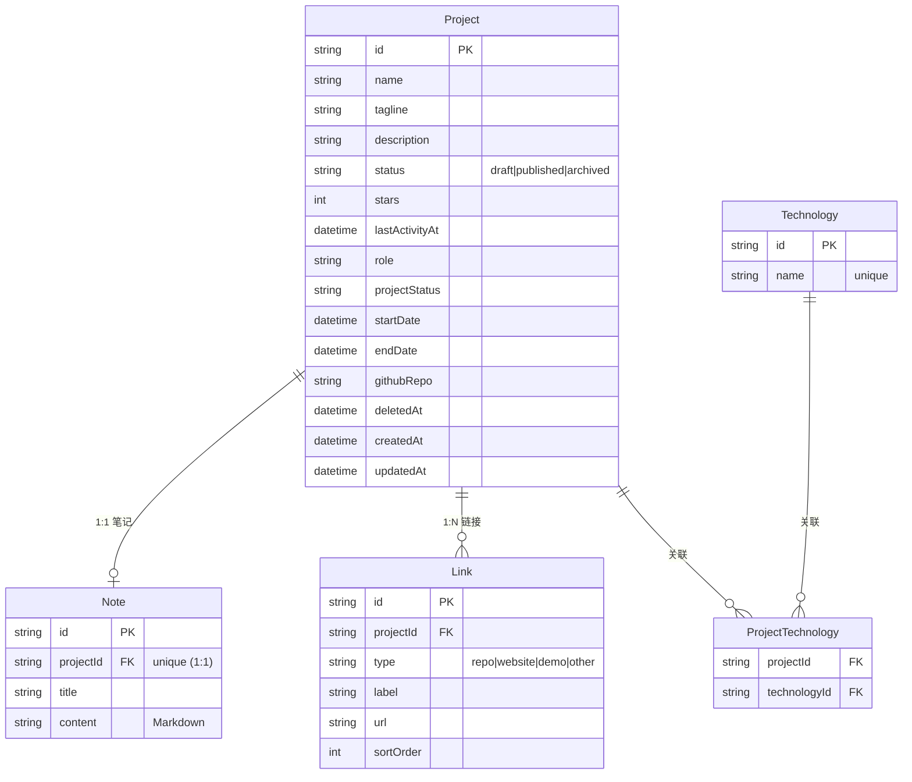

# 数据模型（冻结 · v1.0）

> 实现：`backend/prisma/schema.prisma`；迁移：`backend/prisma/migrations/`
> 数据库：SQLite（MVP），模型与迁移按「平滑迁 PostgreSQL/Supabase」设计。

## 1. ER 总览

## 2. 表与字段

5 张表：`project`、`note`、`link`、`technology`、`project_technology`。

- **project**：核心信息 + 发布生命周期 + 元数据（角色/项目状态/时间范围）+ star/更新时间（手填 P0）+ GitHub 自动拉取预留字段（P1）。
- **note**：`projectId` 加 `@unique` 实现 1:1；纯 Markdown。
- **link**：1:N，`type` 区分仓库/官网/演示/其他，`sortOrder` 排序。
- **technology** + **project_technology**：技术栈为多值标签（支持多技术栈、按技术栈筛选 F6），独立成表避免 JSON 数组无法高效筛选。

## 3. 级联规则（冻结）

| 操作 | 规则 | 说明 |
|---|---|---|
| 删除 Project（物理） | `Note`、`Link` **CASCADE** 删除 | 从属数据随之删除 |
| 删除 Project（物理） | `project_technology` 关联行 **CASCADE** 删除 | **不删除** `technology` 本体（共享词表） |
| 删除 Technology（物理） | 仅删关联行 | 不删项目 |
| 业务「删除项目」 | **软删除**（置 `deletedAt`） | 笔记/链接/元数据全保留，可恢复，满足 N3「不误删笔记 + 可恢复」 |

> 语义区分：`status=archived` 是「下架」（后台仍可见可编辑）；`deletedAt` 非空是「删除」（前台与后台列表均不可见，可恢复）。物理删除仅作为数据治理的运维手段，不在 API 暴露。

## 4. 迁移与「平滑迁 PostgreSQL/Supabase」

- 主键用 `cuid()` 字符串，不依赖 SQLite 自增整型，切 Postgres 不改 ID 类型。
- 不使用 Prisma 原生 enum（SQLite 不支持，会退化为 TEXT），枚举用 `String` + 应用层校验（`src/contract/schemas.ts`）。
- 表/字段名经 `@@map` 固定为 snake_case，规避 Postgres 标识符折叠差异。
- 迁移切换步骤：`schema.prisma` 把 `provider = "sqlite"` 改为 `"postgresql"`，`DATABASE_URL` 指向 Supabase 连接串，`prisma migrate deploy` 重放迁移。

## 5. 索引

| 表 | 索引 | 用途 |
|---|---|---|
| project | `(status, deletedAt)` | 前台/后台列表过滤 |
| project | `(name)` | 名称搜索 |
| link | `(projectId)` | 详情取链接 |
| note | `projectId` unique | 1:1 定位 |
| project_technology | `(projectId, technologyId)` PK + `(technologyId)` | 按技术栈筛选 |
